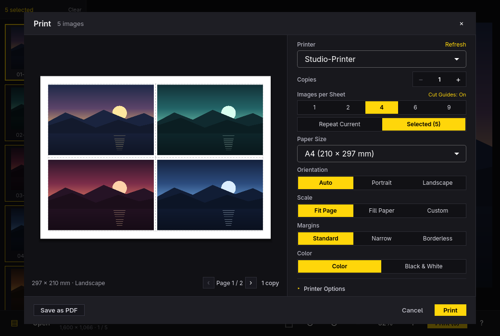

# Peek



Fast image preview, quick editing, and effortless printing for Omarchy — inspired by macOS Preview.

- **One window, keyboard-first**: drop or open any image (PNG, JPEG, WebP, GIF, BMP, TIFF, SVG), browse thumbnails in the sidebar (`Tab`), multi-select images for batch printing, zoom toward the pointer, and undo/redo without ever modifying originals.
- **Quick Edit & Export (non-destructive)**:
  - **Crop & Copy (`S` / `Ctrl+K` / `Ctrl+C`)**: draw a selection with optional aspect-ratio presets (`Free`, `1:1`, `4:3`, `3:2`, `16:9`, `A4`), crop cleanly, or copy image/selection to the clipboard.
  - **Adjust Size (`Ctrl+Shift+R`)**: resize by pixels or percent with proportional lock and quick presets (`50%`, `75%`, `1920`, `1280`, `Original`).
  - **Adjust Color (`Ctrl+Shift+C`)**: live floating HUD for Exposure, Contrast, Saturation, Brightness, plus one-click **Auto Levels**.
  - **Markup Toolbar (`M`)**: draw rectangles, ovals, arrows, lines, freehand sketches, text callouts placed under the pointer, pixelation mosaics, and solid redaction bars — painted by one shared C++ renderer so screen, clipboard, exported images, and printed PDFs match identically.
  - **Image & EXIF Inspector (`I`)**: floating HUD showing dimensions, megapixels, 300 DPI print size, file size, and camera EXIF metadata (camera, lens, shutter, aperture, ISO, focal length).
  - **Export & Convert (`E` / `Ctrl+Shift+S`)**: convert to JPEG, PNG, WebP, TIFF, BMP, or PDF with quality slider and live estimated file size; saves atomically and asks before discarding unexported edits on quit (`Q`).
- **macOS Preview–style print sheet (`Space` / `Ctrl+P`)**:
  - Live paper proof painted by the exact C++ renderer used for PDF/CUPS output.
  - **Presets & Last Used Settings**: automatically remembers your last print settings and preferred printer across launches (resetting Copies to 1 for safety, like macOS), ships built-in presets (*Photo 4×6 Borderless*, *Black & White Draft*, *4-Up Sheet with Cut Guides*), and lets you save/update/delete your own named presets in `~/.config/peek/presets.json`.
  - **Images per sheet (`1`, `2`, `4`, `6`, `9`, `12`, `16`)** with optional dashed **cut guides** — repeat the same image across a sheet or pack multiple selected images across sheets with multi-page preview.
  - **Print Selection**: print only the drawn region without cropping the file.
  - **CUPS Printer Options**: automatically reads Media Type, Print Quality, and Two-Sided options via `lpoptions`.
- **Omarchy native**: follows your active Omarchy accent color, Hyprland corner rounding, and Omarchy desktop language live.

## Keyboard Shortcuts

| Key | Action |
| --- | --- |
| `Space` / `Ctrl+P` / `P` | Open Print Sheet |
| `Enter` | Print (inside Print Sheet) |
| `PgUp` / `PgDn` | Previous / Next Page (inside Print Sheet) |
| `Ctrl+S` | Save as PDF |
| `E` / `Ctrl+Shift+S` | Export / Convert Format |
| `O` / `Ctrl+O` | Open Image |
| `Tab` | Toggle Thumbnail Sidebar |
| `S` / `Shift+Drag` | Select Region to Crop or Print |
| `M` | Toggle Markup Toolbar |
| `I` | Toggle Inspector (EXIF) |
| `Ctrl+K` | Crop to Selection |
| `Ctrl+C` | Copy Image or Selection |
| `Ctrl+Shift+R` | Adjust Size (Resize) |
| `Ctrl+Shift+C` | Adjust Color |
| `Ctrl+A` | Select All Images |
| `←` / `→` (`H` / `L`) | Previous / Next Image in folder |
| `+` / `−` | Zoom In / Out |
| `0` / `F` | Fit to Window |
| `1` | Actual Size (100%) |
| `[` / `]` (`Ctrl+L` / `Ctrl+R`) | Rotate Left / Right |
| `Shift+H` / `Shift+V` | Flip Horizontal / Vertical |
| `Ctrl+Z` / `Ctrl+Shift+Z` | Undo / Redo |
| `T` | Toggle Transparency Grid |
| `?` | Toggle Shortcuts Help |
| `Q` | Quit (asks before discarding unexported edits) |

## Headless CLI

Peek can also be driven without a display:

```sh
peek printers --json
peek presets --json
peek export photo.png -o edited.jpg --crop 100,100,800,600 --resize 640x480 --quality 85 --auto-levels --json
peek export photo.png -o sheet.pdf --preset "4-Up Sheet with Cut Guides" --json
peek print photo.png --preset "Photo 4×6 Borderless" --copies 2 --json
peek skill install
```

## Build, Test, and Install

```sh
./bin/build
./bin/test
./bin/install
```

## License

MIT — see [LICENSE](LICENSE).
